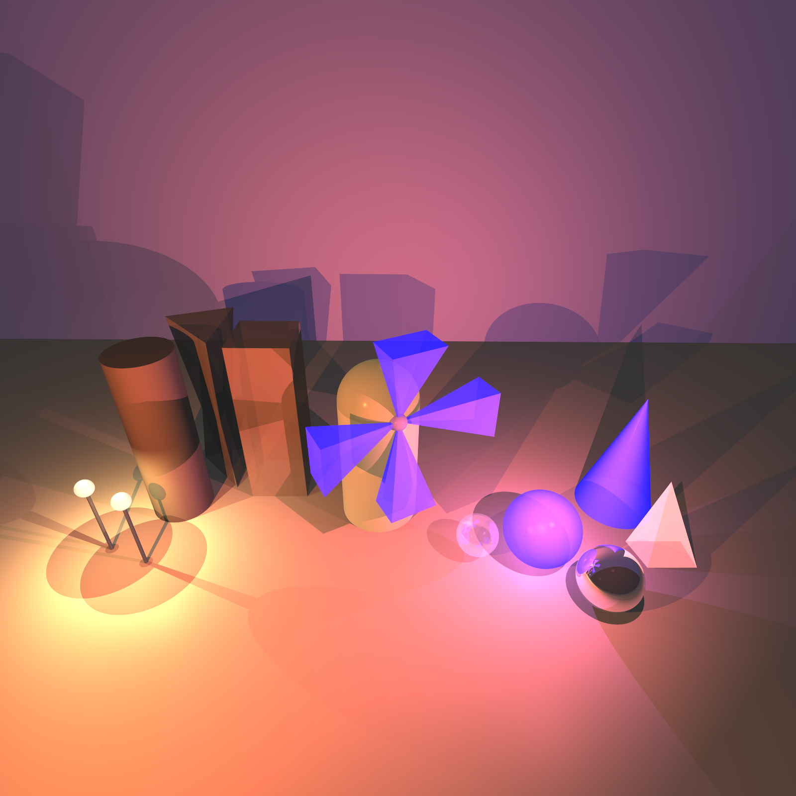
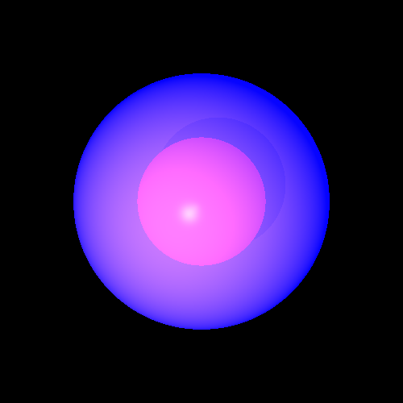
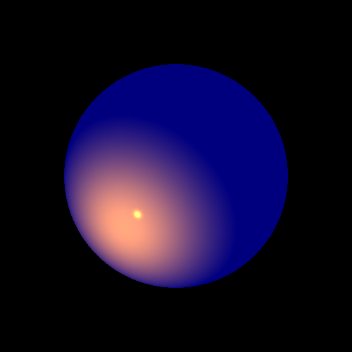
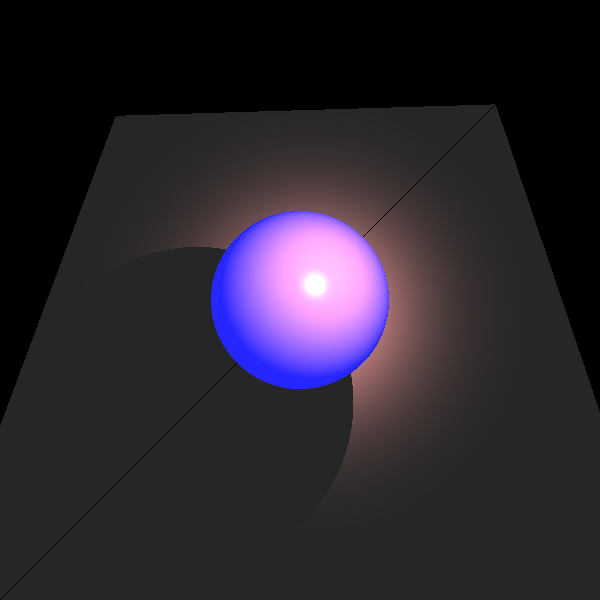

# Ray Tracing Renderer (Java)

A 3D ray tracing engine written from scratch in Java, with no graphics libraries.
It builds a scene out of geometric shapes and light sources, shoots rays through every pixel of a virtual camera and writes the result to a PNG image.



*The final scene: several geometries, three kinds of lights, transparent and reflective objects, shadows and anti-aliasing.*

## Features

- **Geometries:** sphere, plane, triangle, polygon, tube, cylinder, cone, pyramid and box, with a composite `Geometries` container.
- **Lighting:** ambient, directional, point and spot lights, with Phong-style local effects (diffuse and specular).
- **Global effects:** recursive reflection and refraction (recursion depth limited to 10 levels).
- **Shadows:** shadow rays that take the transparency of the occluding objects into account.
- **Anti-aliasing:** multi-ray sampling per pixel, plus **adaptive super-sampling** that only refines the pixels that need it.
- **Multithreading:** a pixel manager that distributes rendering over several threads, or a parallel stream.
- **Scene from XML:** scenes can be described in an XML file (see `xml/`).
- **Builder-style `Camera`:** position, direction, view-plane size and distance, resolution, ray tracer, image writer and quality flags.

## Anti-aliasing comparison

| No improvements | Anti-aliasing | Adaptive super-sampling |
|:---:|:---:|:---:|
|  |  |  |

## More renders

| Reflection and refraction | Spot light on a sphere | Shadows |
|:---:|:---:|:---:|
|  |  |  |

## Project structure

```text
src/
  primitives/   Point, Vector, Ray, Color, Material, Double3, Util
  geometries/   Intersectable, Geometry and all the shapes
  lighting/     LightSource, AmbientLight, DirectionalLight, PointLight, SpotLight
  renderer/     Camera, SimpleRayTracer, ImageWriter, PixelManager
  scene/        Scene, SceneBuilderFromXml
unittests/      JUnit 5 tests (geometries, primitives, renderer)
xml/            example scene description
images/         rendered output
docs/           summary presentation of the mini-projects (Hebrew)
```

## How to run

Requirements: **JDK 17 or newer** and **JUnit 5** (the tests were written with 5.8.1). The project was developed in IntelliJ IDEA.

1. Open the folder in IntelliJ IDEA.
2. Mark `src` as *Sources Root* and `unittests` as *Test Sources Root*.
3. Add JUnit 5 to the project libraries.
4. Run the tests in `unittests/renderer` (for example `MyPicturesTests`, `LightsTests`, `ShadowTests` or `ReflectionRefractionTests`).
   The rendered pictures are written as PNG files into the `images/` folder.

## Tests

The `unittests` folder contains unit tests for the geometries (intersection calculations) and primitives, integration tests between the camera and the shapes, and rendering tests that produce the pictures above.

## Team and credits

Developed by **Efrat Brinkman** and **Naomie Gronstein** as a project in the Software Engineering course at the Jerusalem College of Technology (JCT).
The course skeleton and part of the test files were provided by the course instructor (Dan Zilberstein).
